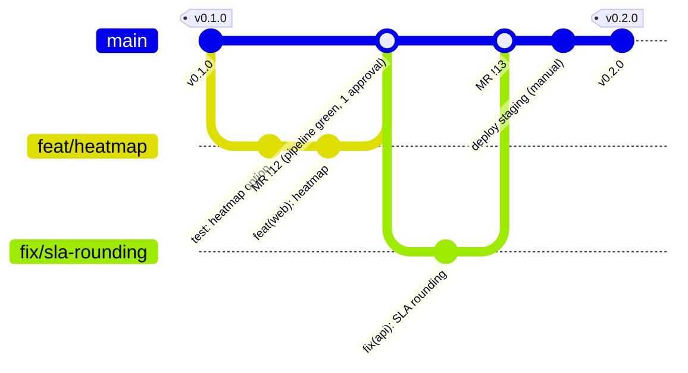

# Way of working (Scrum)

Team: product owner (operations), Scrum master, 2–3 developers (full stack + Data), a Dataiku
referent from the Data team, the run team as stakeholder. Sprints of **2 weeks**.

## 1. Ceremonies

| Ceremony              | When                    | Length  | Output                                                    |
| --------------------- | ----------------------- | ------- | --------------------------------------------------------- |
| Sprint planning       | day 1, morning          | 2 h     | Sprint goal, committed stories, first tasks               |
| Daily stand-up        | every day, 9:30         | 15 min  | Blockers raised; board up to date                         |
| Backlog refinement    | week 1, Thursday        | 1 h     | Stories meeting the Definition of Ready for next sprint   |
| Sprint review (demo)  | last day, afternoon     | 1 h     | Feedback from users; accepted / rejected stories          |
| Retrospective         | last day, after review  | 1 h     | 1–3 improvement actions with an owner                     |
| Architecture / tech sync | every other week     | 45 min  | ADRs proposed or accepted                                 |

## 2. Branch and release workflow

- `feat/*`, `fix/*`, `chore/*` → merge request → `main` (protected, squash or rebase, pipeline
  must pass). `main` is always deployable; every merge builds images and can go to staging.
- A release is a tag `vX.Y.Z` on `main` (SemVer): release notes in `docs/release-notes/`,
  `CHANGELOG.md` updated, then the manual `deploy_production` job after the change approval.
- Hotfix: `fix/*` from `main`, MR, patch tag. No long-lived release branches.

## 3. Definition of Ready

A story enters a sprint when:

- [ ] It has a user-facing goal ("As an N2 supervisor, I want… so that…")
- [ ] Acceptance criteria are testable (given / when / then), including error cases
- [ ] UI stories have a sketch and the French wording; data stories name the KPI formula
- [ ] Dependencies are known (ServiceNow field, DSS connection, IdP, run team)
- [ ] Contract impact identified (API, `ops.daily_service_kpis`, migration) — or "none"
- [ ] Estimated by the team and fits in half a sprint

## 4. Definition of Done

- [ ] Code reviewed and merged through an MR whose pipeline is green (lint, types, tests, hygiene)
- [ ] Tests written first; new behaviour covered at the right level (unit / component / integration)
- [ ] Security checklist of the MR template complete
- [ ] Migrations follow expand → migrate → contract; applied on staging
- [ ] Documentation updated (OpenAPI, user guide, ops docs) in the same MR
- [ ] Deployed to staging and demonstrated to the PO; acceptance criteria verified there
- [ ] No new warning, no known regression, accessibility checked for UI changes

## 5. Code review checklist

Reviewer, in this order:

1. **Intent** — does the MR do what the story asks, nothing more? Is the description clear?
2. **Tests** — do they fail without the change? Do they test behaviour, not implementation?
3. **Correctness** — edge cases (empty period, null `resolved_at`, time zones, DST), error paths.
4. **Security** — validation on every input, authorisation per route, no secrets/PII in logs.
5. **Data** — SQL parameterised; query plan for new queries; migration safe online; contract respected.
6. **Design** — fits the layers (domain imports no framework); names from the domain; no
   speculative abstraction.
7. **Operability** — logs useful, config documented, deploy impact stated.
8. **Docs** — updated; ADR for a structural decision.

Comments are labelled `blocking:`, `suggestion:` or `question:`; the author resolves, the reviewer
approves. Review within one working day.

## 6. Demo script (sprint review, ~20 min)

1. **Context (2 min)** — sprint goal and what the users asked for last time.
2. **Live on staging (12 min)**, logged in as `analyst@ops-pulse.test`:
   - "Vue d’ensemble": period 30 days, service `payments` → KPI tiles; point at an anomaly marker
     on "Volume quotidien d’incidents par service" and explain the z-score in one sentence.
   - "MTTR et dépassement SLA par priorité": P1 vs P4.
   - "Incidents": filter "P1 — Critique", open one, show "Causé par le changement", update its
     state → "Incident mis à jour.".
   - "Changements": "Codes de clôture par service".
   - Log in as `viewer@ops-pulse.test`: same page shows "Lecture seule …".
3. **Under the hood (3 min)** — the pipeline of the merged MR (tests, coverage, image scan) and
   the Dataiku scenario run.
4. **Feedback (3 min)** — questions; new items go to the backlog, not into the sprint.

## 7. Retrospective format

Rotate formats every few sprints to keep it useful; the default is **Start / Stop / Continue**
with a data point:

1. Check-in (5 min): one word for the sprint.
2. Facts (10 min): sprint metrics — goal met?, carry-over, lead time MR open → merge, escaped
   defects, pipeline duration.
3. Generate (15 min): sticky notes Start / Stop / Continue, silent writing then grouping.
4. Decide (20 min): dot-vote, pick 1–3 actions, each with an owner and a check date.
5. Close (5 min): review last retro's actions — done, dropped or carried.

Alternatives: Sailboat (wind / anchors / rocks), 4L (Liked, Learned, Lacked, Longed for), a
timeline retro after an incident.
