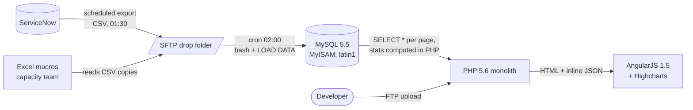

# Analysis of the existing application — SupervIT v1

> **Fictional baseline.** Ops Pulse is a showcase. "SupervIT v1" below is an invented, but
> deliberately typical, legacy operations-supervision application used as the starting point of
> the modernisation. No real system, client or data is described here. The method — inventory,
> data flows, findings with risk and impact, prioritised recommendations — is the one applied on a
> real mission.

**Date:** 2026-10-10 · **Author:** Alexandre Barusta · **Status:** accepted · **Next:**
[target architecture](../architecture/target-architecture.md)

## 1. Scope and method

| Input                     | How it was analysed                                                        |
| ------------------------- | -------------------------------------------------------------------------- |
| Source code (≈ 48 k LOC)  | Read-through of entry points, `cloc`, dependency inventory, grep for SQL built by string concatenation, `eval`, `md5(` |
| Database (MySQL 5.5)      | `information_schema` dump, `SHOW INDEX`, slow-query log over 2 weeks, `EXPLAIN` on the 20 slowest statements |
| Data flows                | Cron tables, FTP/SFTP folders, interviews with the run team                |
| Operations                | Deployment notes (wiki), incident tickets about the app itself, access logs |
| Users                     | 6 interviews (N1/N2 supervisors, service managers, a capacity analyst)     |

## 2. What SupervIT v1 does today

SupervIT gives the operations teams a daily view of IT incidents and changes: open incidents per
service, resolution times, SLA breaches, changes of the week. Data comes from **ServiceNow**
through nightly CSV exports; statistics are computed in PHP at page load.

| Layer       | Technology                                                       |
| ----------- | ---------------------------------------------------------------- |
| Front end   | AngularJS 1.5 (EOL 2021), jQuery 1.11, Highcharts 4 (licence expired), Bootstrap 3 |
| Back end    | PHP 5.6 monolith (EOL 2018), no framework, 1 file per page, SQL in templates |
| Database    | MySQL 5.5 (EOL 2018), MyISAM tables, latin1 charset              |
| Integration | Bash cron on the web server: SFTP pull of ServiceNow CSV at 02:00, `LOAD DATA INFILE` |
| Auth        | Local `users` table, MD5 passwords without salt, PHP session cookie without `Secure`/`HttpOnly` |
| Delivery    | Manual FTP upload of changed files to the production server; no staging |
| Tests       | None                                                             |

### Current data flow

Observations: the CSV import truncates and reloads the tables (no history of state changes); a
failed import leaves the dashboards empty until the next night; the capacity team keeps its own
statistics in Excel from copies of the same CSV, so two MTTR figures circulate.

## 3. Findings

Risk = likelihood × impact on a 1–3 scale each (9 = critical).

| #  | Finding                                                                 | Risk | Impact                                                              | Recommendation                                                        |
| -- | ----------------------------------------------------------------------- | ---- | ------------------------------------------------------------------- | --------------------------------------------------------------------- |
| F1 | PHP 5.6, MySQL 5.5, AngularJS 1.5 are all end of life                   | 9    | No security patches; cannot run on RHEL 9; hiring and support risk  | Rebuild on supported LTS stacks (Node 22, React 19, PostgreSQL 16)   |
| F2 | Passwords hashed with unsalted MD5; session cookie without `Secure`/`HttpOnly` | 9 | Credential theft and session hijack after any DB leak or XSS     | bcrypt (cost 12), short-lived JWT, SAML SSO path; force reset at cut-over |
| F3 | SQL built by string concatenation in 37 places                          | 9    | SQL injection on filter parameters (confirmed on `service=`)        | Parameterised queries only; zod validation of every input             |
| F4 | No index on date columns (`opened_at`, `closed_at`); MyISAM table locks | 6    | Dashboard pages take 8–25 s; the import locks reads for 10 min      | Composite indexes `(service, opened_at)`, partial index on open incidents; InnoDB/PostgreSQL |
| F5 | Statistics computed in PHP at page load, over all rows                  | 6    | Slow pages; two MTTR definitions (PHP vs Excel) disagree             | Compute KPIs once, in Dataiku, into a contract table the API reads    |
| F6 | Nightly CSV import is truncate-and-reload, without monitoring           | 6    | Silent empty dashboards; no history; no incremental sync            | Incremental ServiceNow Table API sync on `sys_updated_on`, monitored  |
| F7 | No automated tests, no CI, no code review                               | 6    | Every change is a production risk; regressions found by users       | Test pyramid (Vitest, Testing Library, integration on real Postgres), GitLab CI gates, MRs |
| F8 | Manual FTP deployments, no staging, no rollback                         | 6    | Half-deployed releases; outages during business hours               | Immutable Docker images, Compose on RHEL 9, scripted deploy/rollback  |
| F9 | Highcharts licence expired; charts hard-coded per page                  | 4    | Licence non-compliance; new visualisations cost days each           | ECharts (Apache-2.0) behind reusable chart components                 |
| F10 | latin1 charset; accented French service names corrupted                | 4    | Wrong labels, broken search                                         | UTF-8 end to end; data migration with explicit conversion             |
| F11 | No structured logs, no health endpoint                                 | 4    | Incidents on SupervIT itself are diagnosed by guesswork             | JSON logs with request id, `/health`, systemd + Docker health checks  |
| F12 | No documentation beyond a wiki page; one developer knows the code      | 6    | Bus factor 1                                                        | Docs as code in the repo, ADRs, knowledge-transfer plan              |
| F13 | Personal data (requester names, e-mails) copied into CSV on SFTP, kept forever | 6 | GDPR: no minimisation, no retention                         | Import only needed fields; pseudonymise; retention policy             |

### Measured baseline (to compare after go-live)

| Metric                                  | SupervIT v1        | Target (Ops Pulse)         |
| --------------------------------------- | ------------------ | -------------------------- |
| p95 load time, "dashboard" page         | 14.2 s             | < 1.5 s (API p95 < 300 ms) |
| Data freshness                          | D+1 02:00, if import succeeds | D+1 06:00 KPIs, live incident lists |
| Deployment duration / frequency         | ~2 h, monthly      | < 10 min, on demand        |
| Automated test coverage                 | 0 %                | ≥ 80 % on domain and KPI code |
| Known critical vulnerabilities          | 3 (F2, F3, F1)     | 0                          |

## 4. Prioritised recommendations

| Priority | Recommendation                                                                 | Findings      | Where in Ops Pulse                                   |
| -------- | ------------------------------------------------------------------------------ | ------------- | ---------------------------------------------------- |
| P0       | Secure authentication: bcrypt, JWT with `iss`/`aud`/`exp`, roles, rate limit on login | F2       | `apps/api/src/adapters/security/`, ADR 0004          |
| P0       | Parameterised SQL and schema validation on every input                         | F3            | `apps/api/src/http/`, ADR 0002                       |
| P1       | New relational model on PostgreSQL 16 with indexes designed for the dashboards | F4, F10       | `db/migrations/`, [detailed design](../architecture/detailed-design.md) |
| P1       | KPIs computed by Dataiku into `ops.daily_service_kpis`, one definition          | F5            | `dataiku/`, ADR 0003                                 |
| P1       | Industrialised delivery: CI gates, images, scripted deploy and rollback        | F7, F8        | `.gitlab-ci.yml`, `deploy/`, ADR 0005                |
| P2       | Incremental ServiceNow sync replacing the CSV import                           | F6, F13       | [ServiceNow integration](../handbook/servicenow-integration.md) |
| P2       | New SPA with reusable ECharts components                                        | F1, F9        | `apps/web/`, ADR 0001                                |
| P3       | Observability: structured logs, health checks, runbook                          | F11           | [operations](../ops/operations.md)                   |
| P3       | Documentation and knowledge transfer                                            | F12           | `docs/`, [KT plan](../knowledge-transfer/plan.md)    |

The rebuild is delivered incrementally with a strangler-fig approach rather than a big-bang
rewrite: see the [migration plan](../migration/migration-plan.md).
