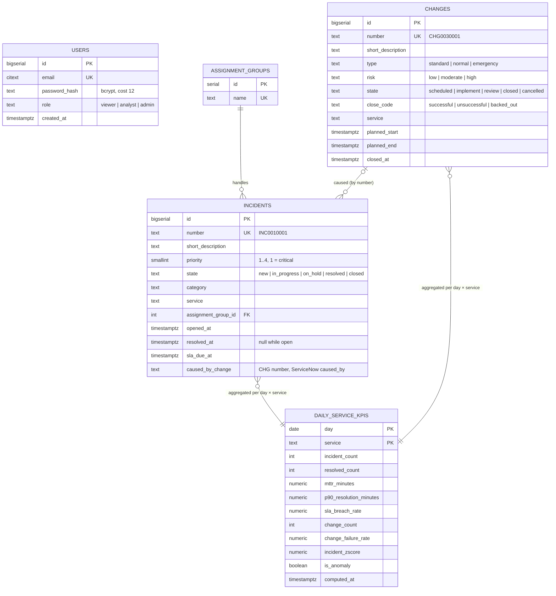

# Detailed design

**Date:** 2026-10-10 · **Status:** accepted · **Parent:** [target architecture](target-architecture.md) ·
**Binding contract:** [`docs/specs/2026-10-10-ops-pulse-contract.md`](../specs/2026-10-10-ops-pulse-contract.md)
(the contract wins over this page if they ever disagree).

## 1. Repository and module layout

| Path                         | Content                                                                  |
| ---------------------------- | ------------------------------------------------------------------------ |
| `apps/api/src/domain/`       | Pure business rules: incident, change, SLA targets, roles, date ranges, KPI shapes |
| `apps/api/src/ports/`        | Interfaces the domain needs: repositories, password hasher, token service, clock |
| `apps/api/src/adapters/`     | `postgres/` repositories (pg), `security/` (bcrypt, JWT)                 |
| `apps/api/src/http/`         | Express app, `routers/`, `middlewares/`, zod `schemas.ts`, error mapper, SAML metadata |
| `apps/api/src/scripts/`      | `migrate.ts` (applies `db/migrations`), `seed.ts` (deterministic demo data) |
| `db/migrations/`             | `0001_init.sql`, `0002_indexes.sql`, … — plain SQL, applied once, in order |
| `apps/web/src/api/`          | HTTP client, zod schemas of every response, endpoint functions          |
| `apps/web/src/state/`        | `auth/` and `filters/` contexts + reducers, `useApiQuery`                |
| `apps/web/src/features/`     | `overview/` (KPI tiles, ECharts option builders), `incidents/`, `changes/`, `shared/` |
| `apps/web/src/i18n/`         | French UI strings (`fr.ts`) and number/date formatting                  |
| `dataiku/project/`           | DSS project export: datasets, recipes (`compute_daily_service_base.sql`, `compute_daily_service_kpis.py`), scenario `daily_kpis`, checks |
| `dataiku/python-lib/ops_kpis/` | KPI library: rates, p90, rolling z-score, output schema               |
| `dataiku/local_runner/`      | Runs the flow outside DSS (`python -m local_runner.run_flow`)            |

## 2. REST API design

Base path `/api/v1`, JSON in camelCase, Bearer JWT. Full list in the contract; the OpenAPI 3.1
document is served at `/api/v1/openapi.json` and browsable at `/api/v1/docs`.

**Conventions**

- Resources are plural nouns; ServiceNow numbers are the public identifiers (`/incidents/INC0010001`),
  database ids never leave the API.
- Lists return `Page<T> = { items, page, pageSize, total }`; `pageSize` ≤ 100; sorting by a
  whitelisted field (`sort=-openedAt`). Server-side filtering only — the SPA never downloads a
  whole table.
- Dates in ISO 8601 UTC; `from`/`to` are inclusive `YYYY-MM-DD` days, default the last 30 days.
- One error shape: `{ "error": { "code", "message", "details"? } }`, codes `VALIDATION_FAILED`
  400, `UNAUTHENTICATED` 401, `FORBIDDEN` 403, `NOT_FOUND` 404, `RATE_LIMITED` 429, `INTERNAL` 500.
- Versioning in the path; a breaking change means `/api/v2` alongside `/api/v1` until clients move.

**Middleware chain** (order matters):

```mermaid
flowchart LR
    rq[request] --> id[request id<br/>X-Request-Id or uuid] --> log[pino-http<br/>redaction] --> hel[helmet] --> cors[CORS allow-list] --> json[express.json<br/>limit 100 kB]
    json --> rl[rate limit<br/>/auth/login 5/min/IP] --> auth[authenticate<br/>JWT HS256 iss/aud/exp] --> role[authorize role] --> val[validate<br/>zod body/query/params] --> h[handler] --> err[error mapper<br/>no stack traces]
```



**Example**

```http
GET /api/v1/incidents?service=payments&priority=1&state=in_progress&page=1&pageSize=25&sort=-openedAt
Authorization: Bearer eyJ…

200 OK
{ "items": [ { "number": "INC0010042", "shortDescription": "Card authorisations time out",
  "priority": 1, "state": "in_progress", "category": "application", "service": "payments",
  "assignmentGroup": "Payments L2", "openedAt": "2026-10-09T07:12:00.000Z", "resolvedAt": null,
  "slaDueAt": "2026-10-09T11:12:00.000Z", "slaBreached": true, "causedByChange": "CHG0030017" } ],
  "page": 1, "pageSize": 25, "total": 1 }
```

**SLA rule** (`apps/api/src/domain/sla.ts`): due time = opened + target by priority (P1 4 h, P2 8 h,
P3 24 h, P4 72 h); an incident is breached when resolved after its due time, or still open past it.

## 3. Data model



`caused_by_change` holds a change **number**, not a foreign key: ServiceNow can reference a
change not yet synchronised, and the sync must not fail on ordering.

**Indexes** (`db/migrations/0002_indexes.sql`), each justified by a query:

| Index                                                        | Serves                                                         |
| ------------------------------------------------------------ | -------------------------------------------------------------- |
| `incidents (service, opened_at)`                             | Incident list filtered by service and period; SQL recipe       |
| `incidents (opened_at) WHERE resolved_at IS NULL` (partial)  | "Incidents ouverts" count — only open rows, stays small        |
| `incidents (opened_at)`                                      | Heatmap and by-priority aggregates over a period, all services |
| `changes (service, closed_at)`                               | Change failure rate per service and day                        |
| `changes (planned_start)`                                    | Change list sorted by planned start                            |
| `incidents (caused_by_change)` (partial, non-null)           | Incidents caused by a change                                   |
| `incidents (assignment_group_id)`                            | FK lookups and deletes on assignment groups                    |
| `daily_service_kpis (day, service)` primary key              | `/kpis/daily` and `/kpis/summary` range scans; idempotent upsert |

Query tuning is verified with `EXPLAIN (ANALYZE, BUFFERS)` on seed volume; see
[`docs/reference/sql/06-query-optimization-and-explain.md`](../reference/sql/06-query-optimization-and-explain.md).

**Migrations.** Plain SQL `NNNN_name.sql`, applied in order by `node dist/scripts/migrate.js`
(`apps/api/src/adapters/postgres/migrator.ts`): all pending files in one transaction (all or
none), under an advisory lock so two migrators cannot race, each recorded with its checksum in
`ops.schema_migrations`. The migrator refuses to run if an applied file changed; a guard hook also
blocks such edits. Rules: [migration plan §4](../migration/migration-plan.md#4-schema-migration-rules).

## 4. KPI definitions

Computed per **day × service** (UTC calendar days) by the Dataiku flow. The SQL recipe
(`compute_daily_service_base.sql`) produces counts, MTTR, p90 (`percentile_cont`) and the
numerators/denominators; the Python recipe (`compute_daily_service_kpis.py` → `ops_kpis`) derives
the rates and the z-score, so that rates re-aggregate correctly over a week or several services (a
ratio of sums, never a mean of daily ratios). Each run recomputes a rolling 120-day window
(ending today, Europe/Paris) in **one transaction** with an idempotent upsert on `(day, service)`.
Reference implementation: `dataiku/project/recipes/` and `dataiku/python-lib/ops_kpis/`
(`rates.py`, `anomaly.py`, `daily_kpis.py`) — if this page and the tested code ever disagree, the
code wins and this page is fixed.

Notation for a day *d* and a service *s*: *R* = incidents of *s* resolved on *d*, with resolution
time *tᵢ = resolved_atᵢ − opened_atᵢ* in minutes; *C* = changes of *s* closed on *d*.

| KPI                         | Formula                                                                                  | Column / API field                                   |
| --------------------------- | ---------------------------------------------------------------------------------------- | ---------------------------------------------------- |
| Incident volume             | number of incidents of *s* opened on *d*                                                 | `incident_count` / `incidentCount`                   |
| Resolved                    | \|R\|                                                                                   | `resolved_count` / `resolvedCount`                   |
| **MTTR**                    | MTTR = (1/\|R\|) · Σᵢ∈R tᵢ — null when \|R\| = 0                                         | `mttr_minutes` / `mttrMinutes`                       |
| **p90 resolution time**     | continuous 90th percentile of {tᵢ}: sort ascending, rank *h = 0.9·(n−1)*, linear interpolation between the values at ⌊h⌋ and ⌈h⌉ (same as SQL `percentile_cont(0.9)`) | `p90_resolution_minutes` |
| **SLA breach rate**         | breached / \|R\|, breached = #{i ∈ R : resolved_atᵢ > sla_due_atᵢ}; 0 when \|R\| = 0     | `sla_breach_rate` / `slaBreachRate` (0..1)           |
| **Change failure rate**     | failed / \|C\|, failed = #{c ∈ C : close_code ∈ {unsuccessful, backed_out}}, *C* = changes closed on *d* (cancelled changes excluded); 0 when \|C\| = 0 | `change_failure_rate` / `changeFailureRate` (0..1) |
| **Incident z-score**        | z_d = (x_d − mean(B_d)) / std(B_d), x = daily incident count, B_d = the 28 days **before** d (d excluded), sample std (ddof 1); undefined with < 7 days of history or zero spread | `incident_zscore` / `incidentZscore` |
| **Anomaly**                 | \|z_d\| ≥ 3 **and** x_d ≥ 5 (a jump from 0 to 2 incidents is not an anomaly)            | `is_anomaly` / `isAnomaly`                           |

Why these choices:

- **p90 next to the mean.** Resolution times are right-skewed: a few week-long incidents pull the
  MTTR up while most are fixed in an hour. p90 says "90 % are resolved within X"; together they
  separate a general slowdown from a few outliers.
- **Baseline excludes the day.** A spike must not dampen its own score. A robust variant (median
  and 1.4826 × MAD) is implemented in `anomaly.py` for services whose history contains incident
  storms.
- **Period summary** (`/kpis/summary`): MTTR over a period is Σ(MTTR_d · resolved_d) / Σ resolved_d
  (weighted, not a mean of means); rates are Σ numerators / Σ denominators; `anomalies` counts
  anomalous day × service rows; `openIncidents` is live (`resolved_at IS NULL`).

## 5. Frontend design

```mermaid
flowchart TB
    App[App + Router] --> AuthP[AuthProvider<br/>useReducer: anonymous | authenticated]
    AuthP --> FiltP[FiltersProvider<br/>period, service]
    FiltP --> Ov["Vue d’ensemble"<br/>KpiTiles + OverviewCharts]
    FiltP --> Inc[Incidents<br/>filters, table, detail panel, form]
    FiltP --> Chg[Changements<br/>table + close-code chart]
    Ov & Inc & Chg --> Q[useApiQuery<br/>AbortController, loading/error/data union]
    Q --> C[api/client.ts<br/>Bearer token, zod parse, ApiError]
```

- **State management: Context API + reducers, no Redux.** Two pieces of global state exist —
  the session and the shared filters — both small and rarely updated; `useReducer` gives the same
  predictable transitions as Redux without the dependency. Each reducer is a pure function with
  its own tests (`authReducer.test.ts`, `filtersReducer.test.ts`). Server data is not copied into
  global state: each view fetches what it shows, keyed on the filters. Redux Toolkit (RTK Query)
  becomes worth it if we add caching across views, optimistic updates or offline mode.
- **Session:** token kept in `sessionStorage` (cleared when the tab closes), validated with zod on
  read; a 401 from any call logs out and shows "Votre session a expiré. Reconnectez-vous.".
- **Permissions:** the UI hides actions the role cannot perform (`permissions.ts`) — a convenience
  only, the API enforces every rule.
- **Charts:** ECharts option builders are pure functions (`volumeOption.ts`, `priorityOption.ts`,
  `heatmapOption.ts`, `changeFailureOption.ts`) tested without a DOM; a thin component mounts
  ECharts, resizes it and disposes it on unmount. Each chart has a text summary for screen readers.
- **Errors:** every API error code maps to a French message (`describeError.ts`); a failed panel
  offers "Réessayer" without breaking the rest of the page.
