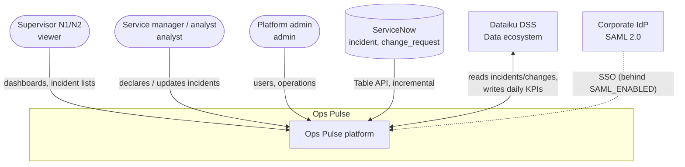
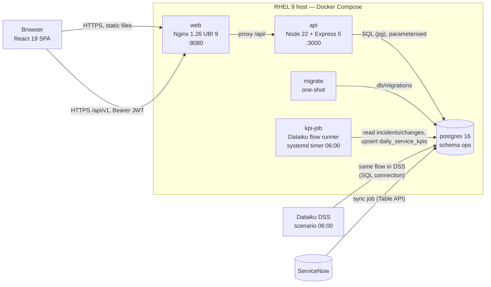
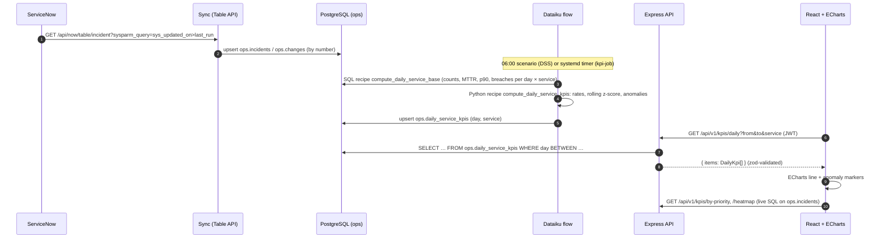
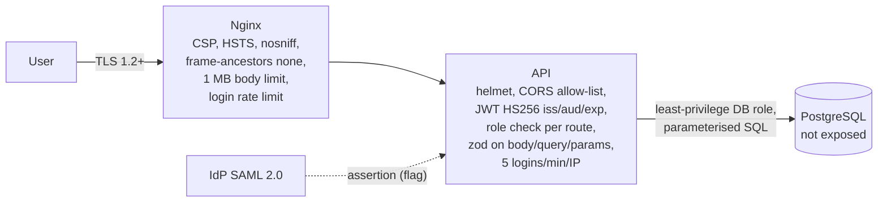
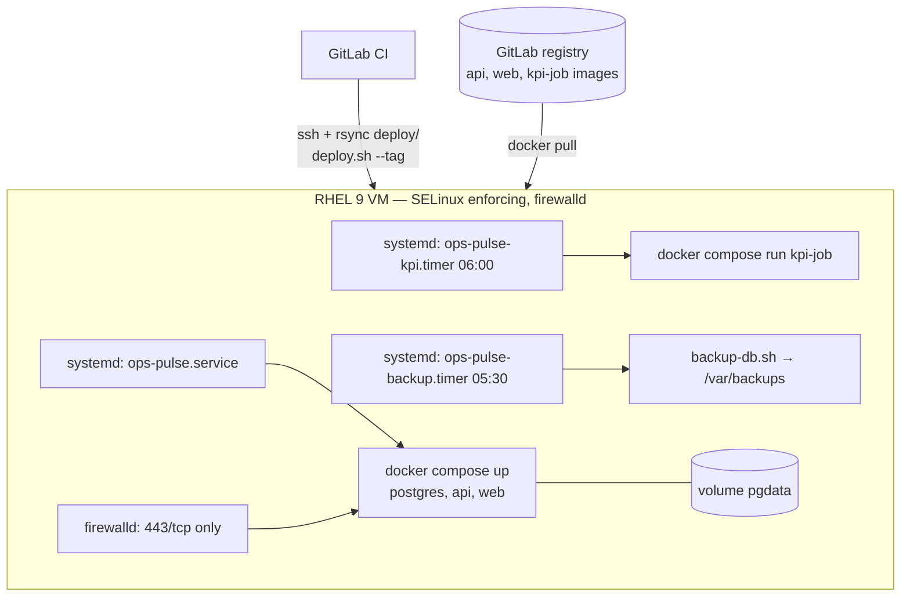

# Target architecture

**Date:** 2026-10-10 · **Status:** accepted · **Inputs:** [legacy analysis](../analysis/legacy-analysis.md),
[contract](../specs/2026-10-10-ops-pulse-contract.md) · **Details:** [detailed design](detailed-design.md)

Ops Pulse replaces SupervIT v1 with four parts, each with one job: a **React SPA** for
supervision dashboards, a **REST API** that owns access to operational data, **Dataiku** that owns
statistics, and **PostgreSQL** as the shared store. They meet at two contracts: the REST API
(`/api/v1`, OpenAPI) and the table `ops.daily_service_kpis`.

## 1. System context

## 2. Containers

| Container   | Responsibility                                                                                         | Must not                                         |
| ----------- | ------------------------------------------------------------------------------------------------------ | ------------------------------------------------ |
| `web`       | Serve the SPA, TLS termination (or behind the corporate LB), security headers, `/api/` reverse proxy   | Hold state or secrets                            |
| SPA         | Dashboards (ECharts), lists with server-side filtering/paging, forms with client validation, French UI | Compute KPIs; trust its own validation           |
| `api`       | AuthN/AuthZ, validation (zod), business rules (SLA, roles), SQL access, OpenAPI, structured logs        | Compute daily statistics (Dataiku owns them)     |
| `postgres`  | Source of truth for incidents, changes, users; the KPI contract table                                   | Be reachable from outside the host               |
| Dataiku     | Data preparation and statistics: SQL recipe (aggregates) + Python recipe (rates, p90, z-score), scenario, API endpoint | Write any table but `ops.daily_service_kpis` |
| `kpi-job`   | Run the same Dataiku flow outside DSS (local runner) on hosts or CI without DSS                         | Diverge from the DSS recipes (same code)         |
| `migrate`   | Apply versioned SQL migrations before the API starts; optional demo seed                               | Run in parallel with another migrate             |

## 3. Data flow: ServiceNow → dashboard

Two freshness levels by design: KPI cards and trends are **daily** (Dataiku, D+1 06:00); incident
and change lists, priority breakdown and heatmap are **live** SQL on the operational tables.

## 4. Responsibilities by layer

**Frontend (`apps/web`).** React 19 + TypeScript strict + Vite. Routing with React Router; pages
`/` ("Vue d’ensemble"), `/incidents`, `/changes`, `/login`. State: React Context for the session
(token, user, role) and the shared filters (period, service), local component state for forms;
server data through a small `useApiQuery` hook with abort on unmount. Every API response is parsed
with zod before use. Charts are ECharts components fed by pure option-builder functions, unit-tested
without a DOM. See [detailed design §5](detailed-design.md#5-frontend-design).

**Backend (`apps/api`).** Node 22, Express 5, TypeScript strict, layered `domain → ports →
adapters → http`. Domain code (SLA, roles, KPI shapes) imports no framework; adapters implement
ports (PostgreSQL repositories, bcrypt, JWT); `http/` holds routers, middlewares (request id,
pino logging, helmet, CORS allow-list, rate limit, auth, zod validation, error mapper). See
[ADR 0002](../adr/0002-express-5-zod-rest-api.md).

**Dataiku (`dataiku/`).** Flow: `incidents_raw` + `changes_raw` (SQL datasets on the `ops`
connection) → `incidents_prepared` → SQL recipe `compute_daily_service_base` → dataset
`daily_service_base` → Python recipe `compute_daily_service_kpis` (code in the project library
`python-lib/ops_kpis`) → `daily_service_kpis` (SQL dataset = `ops.daily_service_kpis`). Scenario
"Daily KPIs": time trigger 06:00 Europe/Paris, sets a rolling 120-day window, forced recursive
build of `daily_service_kpis`, dataset checks, mail to the on-call team on failure. API Designer
endpoint `kpi_lookup` exposes the latest KPIs to other Data consumers. See [ADR 0003](../adr/0003-dataiku-writes-kpi-contract-table.md).

**Database.** PostgreSQL 16, one schema `ops`, `citext` for e-mails, check constraints for every
enumeration, indexes designed from the dashboard queries, versioned plain-SQL migrations applied by
the API's migrator. See [detailed design §3](detailed-design.md#3-data-model).

## 5. Security architecture

- **Identity:** local accounts with bcrypt (cost 12) for v0.1; SAML 2.0 SP behind `SAML_ENABLED`
  for corporate SSO (metadata at `/api/v1/auth/saml/metadata`). See [ADR 0004](../adr/0004-jwt-now-saml-behind-flag.md).
- **Authorisation:** roles `viewer` < `analyst` < `admin`, checked per route on the server.
- **Input:** zod on every body, query and path parameter; errors in one JSON shape, no stack traces.
- **Secrets:** environment only (`.env` mode 600 on the host, GitLab masked variables in CI); never
  in images or git. **Logs:** pino JSON with request id, `password`/`authorization`/`token` redacted.
- **Supply chain:** lock files, `npm ci`, pinned Python requirements, UBI base images, Trivy scan in CI.
- Details and OWASP mapping: [security guide](../ops/security.md).

## 6. Deployment view

- Images: Red Hat UBI 9 (`nodejs-22`, `nodejs-22-minimal`, `nginx-126`, `python-311`), non-root,
  read-only root filesystem in production ([ADR 0005](../adr/0005-ubi9-compose-systemd-rhel.md)).
- Environments: local (Compose, demo seed) → staging (manual deploy from `main`) → production
  (manual deploy of a `vX.Y.Z` tag). Same images everywhere; only `.env` differs.
- Alternative: Nginx or Apache **on the host** in front of the API container
  (`deploy/nginx/ops-pulse.conf`, `deploy/apache/ops-pulse.conf`) when the site standard requires it.

## 7. Non-functional requirements

| NFR             | Target                                                          | How it is met                                                       |
| --------------- | --------------------------------------------------------------- | ------------------------------------------------------------------- |
| Performance     | API p95 < 300 ms on 2 years of data (≈ 200 k incidents); SPA LCP < 2 s | Pre-aggregated KPIs; indexes per query; gzip; immutable hashed assets |
| Availability    | 99.5 % business hours; RTO 1 h, RPO 24 h                        | Health checks, restart policies, daily backups, scripted rollback   |
| Security        | No known critical vulnerability; OWASP ASVS L2 for auth/session | Security baseline, Trivy gate, MR security checklist                |
| Maintainability | Strict TS/mypy, lint with zero warnings, ≥ 80 % coverage on domain/KPI code | CI gates, architecture-as-lint, ADRs                      |
| Observability   | Every request traceable end to end                              | Request id from Nginx to API logs; JSON logs; journald for jobs      |
| Data quality    | KPIs reproducible for any past day                              | Deterministic recipes, idempotent upsert on `(day, service)`, tests  |
| Accessibility   | WCAG 2.1 AA on dashboards                                       | Text summaries of every chart, keyboard navigation, contrast tokens |
| Portability     | Runs on RHEL 9 with Docker or Podman                            | OCI images, Compose spec, no host dependency but the engine         |
