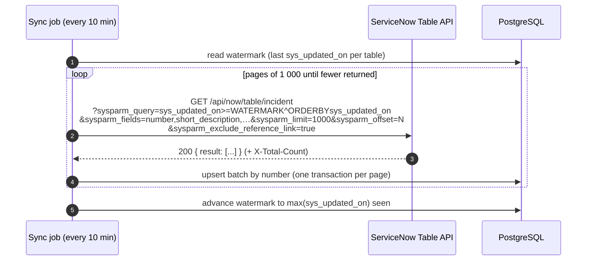
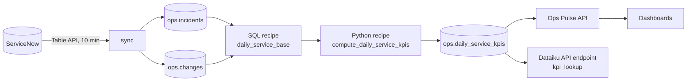

# ServiceNow integration

How ServiceNow incidents and changes reach Ops Pulse and feed the Dataiku flow. v0.1 ships the
target model and a deterministic seed shaped like ServiceNow records; the incremental sync below is
the design for increment 4 of the [migration plan](../migration/migration-plan.md) (it replaces the
legacy nightly CSV export).

## 1. Field mapping

### `incident` → `ops.incidents`

| ServiceNow field (`incident`)            | Ops Pulse column              | Rule                                                                 |
| ---------------------------------------- | ----------------------------- | -------------------------------------------------------------------- |
| `number`                                 | `number`                      | natural key, upsert target (`INC0010001`)                            |
| `short_description`                      | `short_description`           | trimmed, max 160 chars                                               |
| `priority` (1–5, from impact × urgency)  | `priority` 1..4               | `5 - Planning` → 4                                                   |
| `state` (1 New, 2 In Progress, 3 On Hold, 6 Resolved, 7 Closed, 8 Canceled) | `state` | 1→`new`, 2→`in_progress`, 3→`on_hold`, 6→`resolved`, 7→`closed`; 8 skipped (not an incident) |
| `category`                               | `category`                    | display value                                                        |
| `business_service` / `cmdb_ci` (display) | `service`                     | mapped to the 6 supervised services via a reference table; unknown → quarantined |
| `assignment_group` (display)             | `assignment_group_id`         | upsert into `ops.assignment_groups` by name                          |
| `opened_at`                              | `opened_at`                   | UTC (request `sysparm_display_value=false`)                          |
| `resolved_at`                            | `resolved_at`                 | null while not resolved                                              |
| `sla_due` / task_sla `planned_end_time`  | `sla_due_at`                  | from the SLA definition; fallback: Ops Pulse targets by priority     |
| `caused_by` (reference to change_request, display = number) | `caused_by_change` | change **number**, no FK (the change may arrive later)          |
| `caller_id`, `opened_by`, comments, work notes | — not imported —        | data minimisation (GDPR)                                             |

### `change_request` → `ops.changes`

| ServiceNow field (`change_request`)       | Ops Pulse column   | Rule                                                              |
| ----------------------------------------- | ------------------ | ----------------------------------------------------------------- |
| `number`                                  | `number`           | upsert target (`CHG0030001`)                                      |
| `short_description`                       | `short_description`|                                                                   |
| `type` (standard, normal, emergency)      | `type`             | same values                                                       |
| `risk` (2 High, 3 Moderate, 4 Low)        | `risk`             | → `high`, `moderate`, `low` (1 Very High → `high`)                |
| `state` (-5 New … -1 Implement, 0 Review, 3 Closed, 4 Canceled) | `state` | -2 Scheduled→`scheduled`, -1→`implement`, 0→`review`, 3→`closed`, 4→`cancelled`; earlier states skipped |
| `close_code` (successful, successful_issues, unsuccessful) | `close_code` | `successful_issues` → `successful`; backed-out changes (`unsuccessful` + back-out task) → `backed_out` |
| `business_service` (display)              | `service`          | same reference table as incidents                                 |
| `start_date`, `end_date`                  | `planned_start`, `planned_end` |                                                       |
| `closed_at`                               | `closed_at`        |                                                                   |

## 2. Import design (Table API)

- **Authentication:** OAuth 2.0 client credentials (or a dedicated integration user with the
  `snc_read_only` + table read ACLs) — read-only, scoped to `incident`, `change_request`,
  `task_sla`. Tokens cached until expiry; secrets in the vault, not in code.
- **Incremental sync:** `sysparm_query=sys_updated_on>=<watermark>^ORDERBYsys_updated_on`. The
  watermark is stored only after a page is committed; `>=` plus upsert by `number` makes
  re-reading the boundary harmless (at-least-once, idempotent).
- **Pagination:** `sysparm_limit=1000` and `sysparm_offset` advanced by the page size, ordered by
  `sys_updated_on` (then `sys_id`) so pages are stable. For very large backfills, slice the query
  by month instead of deep offsets.
- **Payload size:** `sysparm_fields` lists only the mapped fields; `sysparm_display_value=all` only
  for reference fields that need the display value (service, group, caused_by).
- **Rate limits:** respect the instance's REST rate-limit rules; on `429` wait `Retry-After`;
  on 5xx/timeouts retry with exponential backoff (3 attempts, jitter); every call has a timeout
  (30 s). At most 2 concurrent requests.
- **Deletions:** ServiceNow rarely deletes tasks; a weekly reconciliation compares numbers for
  the last 90 days (`sys_audit_delete` if available).
- **Data quality:** rows failing a mapping rule go to a quarantine table with the reason; the job
  fails (and alerts) above 0.1 % rejects.
- **Where it runs:** as a Dataiku scenario step (Python recipe using the project library and a
  DSS connection holding the OAuth secret), so the Data team owns scheduling and monitoring; or
  as a small Node job reusing the API's repositories.

## 3. How it feeds Dataiku

- `ops.incidents` and `ops.changes` are Dataiku SQL datasets on the `ops` connection; the
  scenario (06:00) builds `daily_service_kpis` recursively from them.
- The sync and the flow are decoupled: the flow reads whatever is synchronised at 06:00; a late
  sync is corrected the next day or by re-running the scenario (upsert on `(day, service)`).
- Change-related KPIs (change failure rate, incidents `caused_by_change`) let service managers
  link incidents to changes in the CAB review — a classic ITIL change-management indicator.
