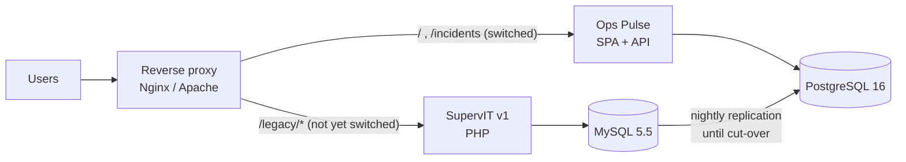

# Migration plan — SupervIT v1 → Ops Pulse

**Date:** 2026-10-10 · **Status:** accepted · **Inputs:** [legacy analysis](../analysis/legacy-analysis.md)
(fictional baseline), [target architecture](../architecture/target-architecture.md)

## 1. Strategy: strangler fig, not big bang

Ops Pulse replaces SupervIT one capability at a time. Both run side by side behind the same
entry point; each capability is switched to Ops Pulse when it is validated by users, and the
legacy page is then removed. At every step, rollback means routing that capability back.



| Increment | Capability moved                                    | Exit criterion                                              | Legacy removed           |
| --------- | --------------------------------------------------- | ----------------------------------------------------------- | ------------------------ |
| 0         | Platform: CI/CD, images, staging, PostgreSQL, nightly MySQL → PostgreSQL copy | Staging deployed from a pipeline; data copy verified | — |
| 1         | Read-only incident and change lists                 | Same counts as SupervIT for 5 consecutive days (§3.4)       | List pages               |
| 2         | KPI dashboards ("Vue d’ensemble") from Dataiku      | MTTR/SLA within 0.5 % of the reconciled reference; users sign off in the sprint demo | Dashboard page, Excel macros |
| 3         | Incident creation / update, authentication (bcrypt, then SAML) | Pilot group uses it for 2 weeks without fallback  | Login, forms             |
| 4         | ServiceNow Table API sync replaces the CSV import   | Incremental sync green for 10 days, lag < 15 min            | Cron, SFTP drop          |
| 5         | Decommission                                        | No legacy route hit for 30 days                             | Servers, MySQL (after archive) |

## 2. Data migration MySQL 5.5 → PostgreSQL 16

### 2.1 Mapping

| MySQL (SupervIT)                                 | PostgreSQL (`ops`)                     | Transformation                                                     |
| ------------------------------------------------ | -------------------------------------- | ------------------------------------------------------------------ |
| `tbl_incident.num`                               | `incidents.number`                     | trim; must match `^INC\d{7}$`, else quarantine                     |
| `tbl_incident.prio` ('1 - Critical' … )          | `incidents.priority` smallint 1..4     | leading digit                                                      |
| `tbl_incident.etat` (FR free text)               | `incidents.state`                      | lookup table (`Nouveau` → `new`, `En cours` → `in_progress`, …)    |
| `tbl_incident.date_ouv` DATETIME, Europe/Paris   | `incidents.opened_at` timestamptz      | `AT TIME ZONE 'Europe/Paris'` (DST-aware)                          |
| `tbl_incident.date_resol` ('0000-00-00')         | `incidents.resolved_at`                | zero date → NULL                                                   |
| —                                                | `incidents.sla_due_at`                 | computed from priority (SLA targets in `apps/api/src/domain/sla.ts`) |
| `tbl_incident.groupe` (text)                     | `assignment_groups` + FK               | distinct names, upsert, then FK                                    |
| `tbl_change.*`                                   | `changes`                              | same rules; `code_cloture` → `close_code` lookup                   |
| `tbl_user.pwd_md5`                               | **not migrated**                       | users re-created; password reset or SAML at first login            |
| latin1 text                                      | UTF-8                                  | `CONVERT(col USING utf8mb4)` on export, then validated              |

### 2.2 Procedure (scripted, rehearsed on staging at least twice)

1. **Freeze** writes in SupervIT (maintenance banner) for the cut-over window; incremental runs
   before cut-over need no freeze.
2. **Extract** with `pgloader` from MySQL into a staging schema `legacy_import` (types cast,
   latin1 → UTF-8, zero dates → NULL):

   ```lisp
   LOAD DATABASE
        FROM mysql://supervit_ro@legacy-db/supervit
        INTO postgresql://ops_pulse_migrator@localhost/ops_pulse
   WITH include drop, create tables, no foreign keys, downcase identifiers,
        preserve index names, workers = 4, concurrency = 1
   SET search_path TO 'legacy_import'
   CAST type datetime to timestamp drop default drop not null using zero-dates-to-null,
        type date drop not null drop default using zero-dates-to-null
   ALTER SCHEMA 'supervit' RENAME TO 'legacy_import';
   ```

   (Credentials come from `~/.pgpass` / the environment, never from the command line.)
   Fallback without pgloader: `mysqldump --tab` CSV + `\copy` into `legacy_import`.
3. **Transform and load** with a versioned SQL script (`INSERT … SELECT` from `legacy_import`
   into `ops.*` with the mapping above, `ON CONFLICT (number) DO UPDATE`): idempotent, so it can
   run nightly during increments 0–3.
4. **Quarantine** rows that fail a rule into `legacy_import.rejected` with the reason; the run
   fails if rejects exceed 0.1 % of rows.
5. **Recompute KPIs** for the whole history with the Dataiku flow (or `kpi-job`).
6. **Reconcile** (§3.4), then `ANALYZE` the new tables.

### 2.3 Rollback

- Before cut-over: nothing to roll back — SupervIT remains the system of record; drop and reload
  `legacy_import`.
- After cut-over of a capability: route it back to SupervIT in the reverse proxy (one config
  change + reload). Writes made in Ops Pulse since cut-over are exported with a prepared SQL
  script and replayed in SupervIT if needed (small volumes: only increment 3 writes).
- Database: a `pg_dump` is taken right before each cut-over (`deploy/scripts/backup-db.sh`);
  restore procedure in [maintenance](../ops/maintenance.md#restore).

### 2.4 Reconciliation queries

| Check                         | Rule                                                                    |
| ----------------------------- | ----------------------------------------------------------------------- |
| Row counts                    | per table and per month, MySQL vs PostgreSQL, difference = rejects      |
| Open incidents                | `count(*) where resolved_at is null` identical                          |
| Checksums                     | `md5(string_agg(number \|\| state \|\| priority, ',' order by number))` per month |
| KPI sample                    | MTTR and SLA breach rate for 3 services × 3 months within 0.5 %         |
| Encoding                      | no `�` (U+FFFD) and no `é`-style mojibake in text columns              |

## 3. Cut-over checklist

- [ ] Rehearsal on staging done twice; timings recorded (target window < 2 h)
- [ ] Communication sent to users (date, window, what changes, support contact)
- [ ] ServiceNow change request approved (CAB) with the rollback plan attached
- [ ] Backup of MySQL (`mysqldump`) and of PostgreSQL (`backup-db.sh`) taken and verified
- [ ] SupervIT writes frozen; banner displayed
- [ ] Final extract → transform → load; rejects < 0.1 % and reviewed
- [ ] KPI flow run for the full history; dashboards checked against the reference figures
- [ ] Reconciliation queries all green and archived with the change record
- [ ] Reverse proxy switched; smoke test (`deploy.sh` checks + manual login with a pilot user)
- [ ] Monitoring watched for 1 h (5xx rate, API p95, KPI job status)
- [ ] Go / no-go decision recorded; on no-go, routing reverted and SupervIT unfrozen
- [ ] Hypercare: daily check-in with the pilot users for 2 weeks

## 4. Schema migration rules

Applied to every change in `db/migrations/` once Ops Pulse is live:

1. **Never edit an applied migration.** Fix forward with a new `NNNN_name.sql`. A guard hook
   (`.claude/hooks/guard-migrations.mjs`) blocks edits to tracked migration files.
2. **Expand → migrate → contract**, across at least two releases, so that release N and N−1
   both run on the schema at every moment (this is what makes `rollback.sh` safe without a
   schema rollback):
   - *expand*: add the new column/table/index, nullable or with a default; write both shapes;
   - *migrate*: backfill in batches; switch reads to the new shape;
   - *contract*: in a later release, drop the old column once nothing reads it.
3. **Online-safe DDL:** on large tables, indexes are built with `CREATE INDEX CONCURRENTLY`,
   which cannot run inside a transaction — the migrator applies pending files in one transaction,
   so such an index is created as a documented manual step (or the migrator gains a
   non-transactional mode first) and the migration then uses `CREATE INDEX IF NOT EXISTS`; add `NOT NULL` via a `CHECK … NOT VALID` then `VALIDATE CONSTRAINT`; set
   `lock_timeout` (e.g. `SET lock_timeout = '5s'`) so a migration fails rather than blocking traffic.
4. **One concern per migration**, named for what it does (`0007_add_incident_impact.sql`).
5. **The KPI table is a contract** with Dataiku: changing it means updating the contract spec,
   the flow's output schema (`ops_kpis/schema.py`), the API and the SPA in the same release train.
6. Every migration is applied in CI (integration tests on a fresh PostgreSQL) and on staging
   before production; its duration on production-sized data is stated in the MR.

Reference: [`docs/reference/sql/10-safe-schema-migrations.md`](../reference/sql/10-safe-schema-migrations.md).
