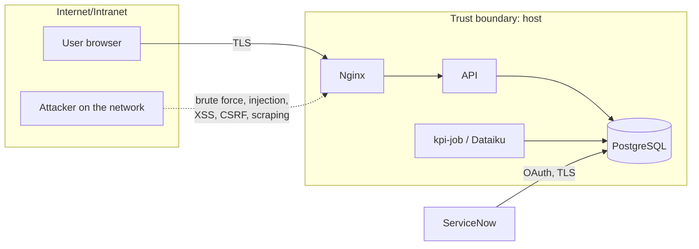

# Security guide

Scope: the Ops Pulse platform (SPA, API, PostgreSQL, Dataiku flow, deployment). Baseline from the
[contract](../specs/2026-10-10-ops-pulse-contract.md#security-baseline); decisions in
[ADR 0004](../adr/0004-jwt-now-saml-behind-flag.md) and [ADR 0005](../adr/0005-ubi9-compose-systemd-rhel.md).

## 1. Threat model summary

Assets: operational data (incidents, changes — may mention internal systems and people), user
accounts, the KPI figures used in management reporting, the `JWT_SECRET` and database credentials.

| STRIDE                  | Threat                                              | Mitigation                                                                   |
| ----------------------- | --------------------------------------------------- | ---------------------------------------------------------------------------- |
| Spoofing                | Password guessing, stolen token                     | bcrypt cost 12; login rate limit 5/min/IP (API) + Nginx limit; JWT `exp` 1 h, `iss`/`aud` checked; SAML SSO option |
| Tampering               | SQL injection, mass assignment                      | Parameterised SQL only; zod schemas with explicit fields (unknown keys stripped/rejected) |
| Repudiation             | "I did not change this incident"                    | JSON logs with request id, user id and route for every write                 |
| Information disclosure  | Stack traces, verbose errors, logs with secrets     | Error mapper returns codes only; pino redaction of `password`, `authorization`, `token`; DB not exposed |
| Denial of service       | Large bodies, expensive queries                     | 1 MB body limit (Nginx), small JSON limit (API), `pageSize` ≤ 100, indexed queries, resource limits per container |
| Elevation of privilege  | Viewer calling analyst routes                       | Role check on the server for every route; tests for each forbidden case     |

## 2. Authentication and session

- Passwords: bcrypt, cost 12, never logged, never returned. Minimum length enforced at creation.
- Tokens: JWT HS256 signed with `JWT_SECRET` (≥ 32 random chars), claims `sub`, `role`, `iss`,
  `aud`, `iat`, `exp` (TTL `JWT_TTL_SECONDS`, default 3600). Verification pins the algorithm.
- The SPA keeps the token in `sessionStorage` and sends it as `Authorization: Bearer`; no cookie,
  so no CSRF surface. The strict CSP (no inline script, `connect-src 'self'`) is the XSS control.
- SAML 2.0 (flag `SAML_ENABLED`): SP metadata at `/api/v1/auth/saml/metadata`; assertions must be
  signed by `SAML_IDP_CERT`, audience = `SAML_ISSUER`; the API then issues its own JWT.
- Authorisation: `viewer` (read), `analyst` (read + create/update incidents), `admin` (all).

## 3. OWASP Top 10 (2021) mapping

| OWASP                                  | Control in Ops Pulse                                                                 |
| -------------------------------------- | ------------------------------------------------------------------------------------ |
| A01 Broken access control              | Role middleware per route; default deny; numbers as ids; tests for 401/403 paths     |
| A02 Cryptographic failures             | TLS at Nginx/LB with HSTS; bcrypt; secrets only in env; no sensitive data in URLs    |
| A03 Injection                          | `pg` parameters (`$1`); zod on body/query/params; sort fields whitelisted; React escapes output |
| A04 Insecure design                    | Threat model above; ADRs; security checklist in every MR                            |
| A05 Security misconfiguration          | helmet; CSP and headers in Nginx; non-root, read-only containers; `server_tokens off`; no default credentials outside the seed |
| A06 Vulnerable components              | Lock files, `npm ci`, pinned Python deps, UBI images, Trivy gate on critical CVEs, monthly updates |
| A07 Identification & authentication    | Rate limit, generic login error ("E-mail ou mot de passe incorrect."), short TTL, SSO option |
| A08 Software & data integrity          | Images built only by CI from reviewed `main`/tags; protected branches; deploy over SSH with pinned known_hosts |
| A09 Logging & monitoring failures      | Structured logs with request id; failed logins logged; health and KPI-job alerts    |
| A10 SSRF                               | The API makes no outbound calls from user input; the ServiceNow URL is configuration |

**Database roles (least privilege, recommended for production):** the API role reads/writes
`ops.incidents`, `ops.changes`, `ops.users` and reads `ops.daily_service_kpis`; the KPI flow role
(DSS connection or `kpi-job`) reads `ops.incidents`/`ops.changes`, has `TEMP` on the database (the
runner stages rows in a temporary table) and `INSERT, UPDATE` on `ops.daily_service_kpis` only;
the migrator role owns the schema. The demo Compose stack uses a single owner role for simplicity.

## 4. Secrets handling

| Secret               | Where it lives                                                    | Never                              |
| -------------------- | ----------------------------------------------------------------- | ---------------------------------- |
| `JWT_SECRET`, `POSTGRES_PASSWORD` | `/opt/ops-pulse/deploy/compose/.env`, mode 600, root; or a vault injecting env vars | git, images, logs, tickets |
| Registry access      | Read-only deploy token, `docker login` on the host                | personal tokens                    |
| SSH deploy key       | GitLab CI file variable, protected + masked, per environment       | shared between environments        |
| ServiceNow OAuth client | Vault / DSS connection secrets                                  | in recipe code                     |

The values in `deploy/compose/.env.example` and in CI test jobs are fake, dev-only placeholders.
Rotation procedures: [maintenance](maintenance.md#rotating-the-jwt-secret).

## 5. Data protection (GDPR / RGPD)

- **Minimisation:** Ops Pulse stores incidents and changes without caller names, e-mails or phone
  numbers; the ServiceNow sync imports only the fields of the mapping
  ([ServiceNow integration](../handbook/servicenow-integration.md)). User accounts hold an
  e-mail and a role only.
- **Free text** (`short_description`) can contain personal data typed by agents: it is shown to
  authenticated users only, never logged, and covered by the retention below.
- **Retention:** operational records 25 months (24 months of trends + current month), then
  purged (manual in v0.1, scheduled job planned for v0.2); KPI aggregates (no personal data) kept 5 years; logs 30 days;
  backups 14 days.
- **Rights:** access/erasure requests for a user account are handled by an admin (delete the
  account; history keeps no reference to it).
- **Records:** the processing is registered in the client's GDPR register (purpose: IT operations
  supervision; legal basis: legitimate interest); hosting in the EU on the client's servers.

## 6. Incident response

1. Contain: block the source (firewalld, Nginx `deny`), rotate the exposed secret, disable the
   affected account.
2. Preserve: export logs (`opc logs --no-color > /root/incident-<date>.log`), keep the last backup.
3. Notify: security officer within 1 h; the DPO decides on CNIL notification (72 h) if personal
   data is involved.
4. Recover and review: fix, redeploy, post-mortem with actions.

## 7. Security checks in the pipeline

- Lint and strict types (no `any`, no unchecked casts); tests for auth and authorisation paths.
- `npm audit --omit=dev` reviewed monthly; Trivy blocks images with a fixable critical CVE.
- MR template security checklist; a second reviewer for anything touching auth, SQL or headers.
