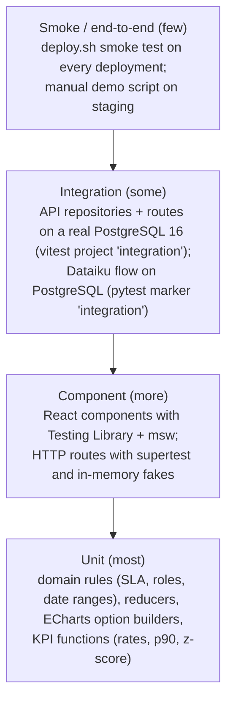

# Test strategy

Tests are written first (red → green → refactor, `AGENTS.md` §2) and run on every commit
(pre-commit hook, partial) and every pipeline (CI, complete).

## 1. Pyramid

| Level        | Tooling                                   | Location                                        | Runs where                       |
| ------------ | ----------------------------------------- | ----------------------------------------------- | -------------------------------- |
| Unit         | Vitest (web, api), pytest (Dataiku)       | next to the code: `*.test.ts`; `dataiku/tests/` | pre-commit (lint/types), CI      |
| Component    | Vitest + Testing Library + jsdom + msw (web); supertest + fakes (api) | `apps/web/src/**/*.test.tsx`, `apps/api/src/http/*.test.ts` | CI |
| Integration  | Vitest project `integration` + PostgreSQL service; pytest `-m integration` | `apps/api/src/**/*.int.test.ts`, `dataiku/tests/` | CI (`api:test:integration`), locally with Docker |
| Static       | ESLint (`--max-warnings=0`), `tsc` strict, ruff, mypy strict, knip, jscpd, shellcheck, `docker compose config` | — | pre-commit + CI |
| Agent harness| `node --test`                             | `tools/agent-harness/`                          | pre-commit + CI                  |
| Smoke        | `deploy/scripts/deploy.sh` checks         | —                                               | every deployment                 |
| Security     | Trivy image scan; auth/role tests         | CI `image:scan`                                 | `main` and tags                  |

## 2. What each level must prove

- **Domain/KPI unit tests:** every business rule and formula of the
  [detailed design](../architecture/detailed-design.md#4-kpi-definitions), including edges (no
  resolved incident, single value p90, flat history → undefined z-score, DST days).
- **Route tests:** for each endpoint — happy path, validation error (`VALIDATION_FAILED`),
  unauthenticated (401), forbidden role (403), not found (404), error shape.
- **Integration tests:** SQL correctness (filters, paging, sorting, aggregates) on a migrated
  database; migrations apply from scratch.
- **UI tests:** user-visible behaviour with French labels (queries by role and text), loading /
  empty / error states, role-dependent actions.

Coverage targets: ≥ 80 % lines on `domain/`, `ops_kpis/`, reducers and option builders; coverage is
reported, not used to block a merge — a missing behaviour test is a review finding.

## 3. Execution reports in CI

| Job                     | JUnit report                                  | Coverage                                         |
| ----------------------- | --------------------------------------------- | ------------------------------------------------ |
| `agent-harness`         | `harness-junit.xml` (Node test reporter)      | —                                                |
| `web:test`, `api:test`  | `apps/*/reports/junit.xml` (Vitest `junit` reporter) | Cobertura `apps/*/coverage/cobertura-coverage.xml`; text summary parsed by the job's `coverage` regex |
| `api:test:integration`  | `apps/api/reports/junit-integration.xml`      | —                                                |
| `dataiku:test`          | `dataiku/reports/junit.xml` (`pytest --junitxml`) | `pytest-cov` Cobertura `dataiku/reports/coverage.xml`, `TOTAL` line parsed |
| `image:scan`            | —                                             | Trivy report (`container_scanning`)              |

GitLab shows the JUnit results in the merge request ("Test summary": new failures, fixed tests),
the coverage percentage per job and in the MR, and line coverage in the diff (Cobertura). Reports
are kept 30 days as job artifacts (`when: always`, so failed runs keep theirs). For a release,
the pipeline of the tag is the **test execution report** attached to the change record.

## 4. Test data

- Deterministic seed (`apps/api/src/seed/`): 6 services, demo users, incidents and changes over
  recent months with known anomalies — same data in dev, CI integration and demos.
- Unit tests build their own minimal data; no test depends on the seed's exact content except
  smoke checks.
- No production data in any environment below production.

## 5. Not automated (yet)

- Browser end-to-end tests (Playwright) on the composed stack — candidate for v0.2, run nightly
  against staging.
- Load tests (k6) on `/kpis/*` and `/incidents` with 2 years of synthetic data — before go-live.
- Accessibility audit with axe on the three pages — manual check in each review for UI changes.
